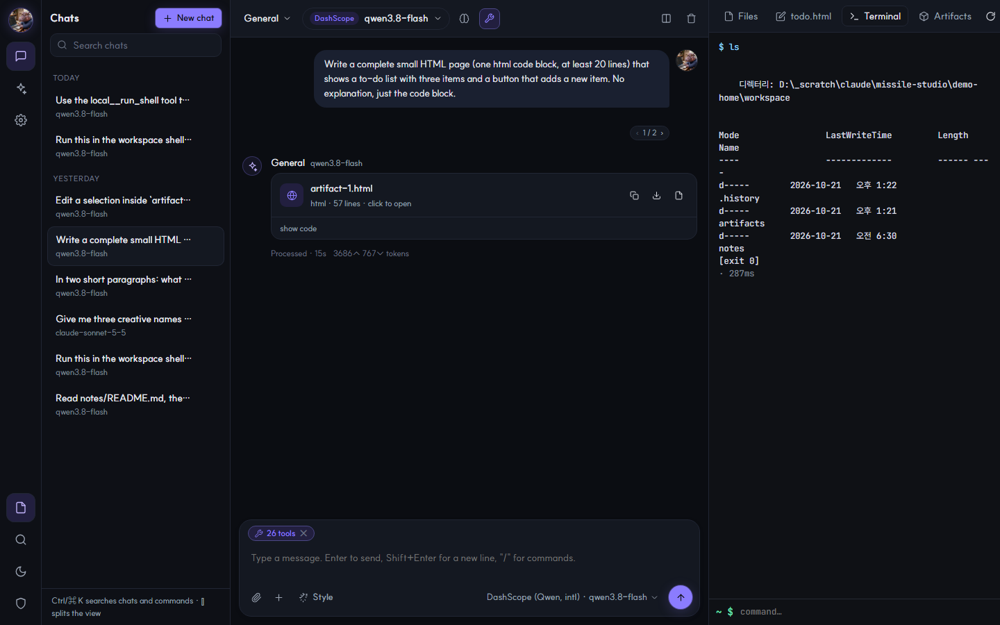

# missile studio

**Your own LLM studio.** Many model providers, your local MCP servers and remote agent servers in one
place, driven by one agent loop. A web UI and a terminal UI share the same engine, so the same setup
works on a laptop, on a headless box over SSH, in Docker, or behind a tunnel.

Pure Python, installs in one line, remote-first. `missile` and the short alias `ms` are the same command.

```
   providers ──┐                                    ┌── web UI  (http://host:7700)
 OpenAI · Claude · Gemini · DashScope · OpenRouter   │
 Groq · DeepSeek · Mistral · xAI · Ollama · vLLM    │
 LM Studio · llama.cpp · LiteLLM · agent servers    ├── missile engine ──┬── terminal  (ms chat / ms ask)
                                                    │  (agent loop,      │
   tools ───────┤                                   │   policy, audit)   ├── MCP hub   (ms hub → Claude Code, Cursor, Claude Desktop)
 local: shell · files · search · fetch              │                    │
 MCP:  stdio · streamable-http · sse (any server)   ┘                    └── device bridge (ms bridge → remote agents use your PC)
```

## Screenshots

**Sign in.** Dark by default, one geometric face for Latin and Hangul (SUIT, served by the studio itself, no
font CDN), and your own picture as the mark and the tab icon (`static/brand/`, three files: replace them to
rebrand). Accounts have roles: admins run the studio, users chat. Sign-up on the login page can be closed,
invite-only (default, with a code shown in the admin console) or open. A session lasts 30 days when you ask it to.


**Chat.** Icon rail, chat list grouped by day, one conversation in the middle. Assistant and model are
pills in the top bar, so you can switch mid-conversation. Every tool call is a collapsible card inside
the answer: name, arguments, result, policy decision and duration. Markdown, code blocks with copy,
thinking blocks, token usage. Edit any of your messages and resend: the chat forks, a small
`‹ 1 / 2 ›` under the message switches between versions, and *Retry* forks the answer the same way.
A writing style (Normal, Concise, Explanatory, Formal, Friendly, or your own) can be set per chat.
Dark by default, with warm and light themes.


**Model picker · presets · thinking.** The model pill opens with three quick picks, *Fast / Think / Best*,
derived from your providers (or set your own in Settings → Defaults & presets), then every model of every
provider with search. The brain button cycles thinking per chat (provider default → on → max → off);
each provider gets its own switch underneath (budgets, reasoning effort, `enable_thinking`), so one
toggle works everywhere.


**Approvals.** When a tool is `ask`-level (destructive hint, dangerous shell pattern, or your rule) the turn
pauses and a card appears in the flow: *Allow once · Allow for this chat · Always allow · Deny*. The same
prompt appears inline in the terminal UI.


**Settings → Model providers.** Three columns like a desktop client: settings nav, provider list with a
status dot, and the detail with an enable switch, key field (never sent back to the browser), *Test*,
*Discover models* and the model list as chips (click one to make it the default).


**Settings → MCP servers.** Status, tool count and transport per server, the tools it exposes with
read-only / destructive flags, restart, and one-click import from Claude Code, Claude Desktop, Cursor,
Windsurf, VS Code or Cherry Studio.


**Split view · run chats side by side.** Up to three panes, each with its own conversation and model.
Streams run concurrently; the chat list shows a pulsing dot on anything still answering, and switching
chats never interrupts a running turn. *Link inputs* sends one message to every pane, so you can compare
models on the same prompt.


**Workspace drawer · files, editor, terminal.** The folder your local tools work in, as an IDE-style
drawer: browse the tree (it refreshes after the agent writes), open and edit files (`Ctrl/⌘ S` saves),
ask the active chat about the open file, and run commands in the server-side shell. Writes and commands
need the admin role and land in the audit log.



**Artifacts.** Long code blocks and HTML / SVG / Markdown / JSON documents in an answer become cards.
Open one in the drawer for a live sandboxed preview or the code, copy it, save it into the workspace
(previous versions are kept), or send it to the editor.


**Editor · edit a selection with the model.** Select text in the editor and a small bar appears: type an
instruction, or *Fix / Comment / Explain / Review*. Replacements come back as a diff you apply or
discard. Every save keeps the previous version; *Versions* lists them and shows the diff before you
restore one.


**Search & commands.** `Ctrl/⌘ K` searches chats, runs any command (new chat, split, drawer, theme,
settings pages) or asks a question straight away. `/` at the start of the message box lists slash
commands (`/new /split /files /terminal /artifacts /tools /think /style /assistant /tool …`).
`Ctrl/⌘ /` shows every shortcut. A long paste becomes an attached file instead of a wall of text.


**Admin console (`/admin`).** A separate, password-protected console: dashboard with warnings and
24h activity, providers & MCP health with test/restart, access tokens with scopes, typed settings that
apply immediately, event log, system status, retention. See [docs/GUIDE-admin.md](docs/GUIDE-admin.md).


## Install (anywhere)

```bash
# Linux / macOS / WSL
curl -fsSL https://raw.githubusercontent.com/jinsoo96/missile-studio/main/scripts/install.sh | sh

# Windows PowerShell
irm https://raw.githubusercontent.com/jinsoo96/missile-studio/main/scripts/install.ps1 | iex

# or by hand (Python 3.10+)
pip install "git+https://github.com/jinsoo96/missile-studio.git"
uv tool install "missile-studio @ git+https://github.com/jinsoo96/missile-studio.git"
pipx install "git+https://github.com/jinsoo96/missile-studio.git"

# Docker
docker run -d --name missile -p 7700:7700 -v missile-data:/data -e MISSILE_TOKEN=change-me ghcr.io/jinsoo96/missile-studio:latest
```

## 60 seconds

```bash
ms p add --preset openai --api-key sk-...      # provider: openai / anthropic / gemini / dashscope / openrouter / groq ...
ms p add --preset ollama --model qwen3:8b      # local, no key
ms m import claude-code                        # reuse the MCP servers you already use in Claude Code
ms m add fs -- npx -y @modelcontextprotocol/server-filesystem .   # or add any server by hand
ms doctor                                      # providers + MCP servers health
ms serve --open                                # web UI  → http://127.0.0.1:7700
ms chat                                        # terminal chat, same engine
ms ask --json "summarize README.md with local__read_file"   # scripting
```

Short forms: `ms s` (serve) · `ms c` (chat) · `ms a` / `ms q` (ask) · `ms p` (provider) · `ms m` (mcp) ·
`ms h` (hub) · `ms b` (bridge) · `ms dr` (doctor) · `ms admin` (users, tokens) · `ls` / `rm` inside `p`, `m` and `assistant`.

Config lives in `~/.missile-studio/config.json` (override with `MISSILE_HOME`). Secrets can stay out of
the file with `--api-key-env OPENAI_API_KEY`.

## What you get

| | |
|---|---|
| **Providers** | OpenAI-compatible (OpenAI, vLLM, Ollama, LM Studio, llama.cpp, DashScope, OpenRouter, Groq, DeepSeek, Mistral, xAI, LiteLLM, any gateway), Anthropic Messages API, Google Gemini, **remote agent servers**. Streaming, native tool calling, thinking/reasoning deltas, model discovery, per-provider `extra_body` (Qwen `enable_thinking`, etc.). |
| **MCP client** | stdio / streamable-http / sse servers, one supervised connection each (ping, backoff reconnect, per-call timeout, stderr logs). Tool names are `server__tool`. Import from Claude Code, Claude Desktop, Cursor, Windsurf, VS Code, Cherry Studio or pasted JSON. Export back as standard `mcpServers` JSON. |
| **Local tools** | `local__run_shell`, `read_file`, `write_file`, `list_dir`, `search_files`, `fetch_url`, `now`. Sandboxed to a workspace folder (symlink-safe). |
| **Policy & approvals** | Per-tool `allow / ask / block` (globs like `fs__*`), read-only tools allowed by default, destructive hints and dangerous shell commands (`rm -rf`, `git push --force`, `curl | sh` ...) always ask. Approve once / for this chat / always, in the browser or in the terminal. Every call lands in an **audit log**. |
| **Harness** | One agent loop for every provider: tool calls of a turn run concurrently (4 at a time, approvals still one by one), provider errors before any output are retried with backoff (429, 5xx, connection), long threads are compacted by the model itself into a summary that replaces the old part (the recent tail stays verbatim), Anthropic requests cache the system prompt and tool list and replay thinking blocks with their signatures so extended thinking works through tool loops. |
| **Models & presets** | Quick picks *Fast / Think / Best* at the top of the model picker, derived from your providers or configured in Settings → Defaults & presets. A per-chat thinking toggle (default / on / max / off) mapped to each provider's own switch: Anthropic budgets, reasoning effort on reasoning models, `enable_thinking` for Qwen-style servers, Gemini thinking budgets. Every provider is probed in the background (and after every turn): models whose server is unreachable or whose key is missing are dimmed in the picker with the reason, and the model button carries a small reachability dot. |
| **Assistants & styles** | Assistants: system prompt + preferred provider/model + tool set + iteration cap. Writing styles (Normal, Concise, Explanatory, Formal, Friendly, or your own) switch the tone per chat without touching the assistant. |
| **Search & memory** | Search chats by their contents, any language (FTS5 trigram), with snippets in the sidebar. Memories outlive a chat: the assistant saves facts with `memory_save`, recalls the best matches into every answer, and you edit the list in Settings → Memory. |
| **Web & research** | `web_search` through one search API (DuckDuckGo without a key, or Tavily / Brave / Serper / SearXNG) plus `fetch_url`. Research mode in the composer plans sub-questions, searches, reads sources and writes a report with numbered citations. |
| **Knowledge base** | Index folders and files (Markdown, text, code, PDF with pypdf) into chunks: keyword search always, embeddings through any OpenAI-compatible `/embeddings` endpoint when configured, fused by reciprocal rank. Switch on Knowledge in the composer to put excerpts into context, or let the assistant call `knowledge_search`. |
| **Conversations** | SQLite, resumable, attachments (text/code/markdown/pdf*/images), markdown rendering, thinking blocks, tool cards. Edit a message to fork the chat; every branch is kept and `‹ ›` switches between them; retry forks the answer. Many chats can run at once; split the view into up to three panes and link their inputs to compare models. A turn keeps running on the server when the tab closes: open the chat again and it reattaches, replaying what you missed. |
| **Artifacts** | Long code blocks and HTML / SVG / Markdown / JSON documents become cards with a sandboxed live preview, copy, save to the workspace and open-in-editor. |
| **Workspace** | IDE-style drawer over the local-tools folder: file tree, editor with save, selection editing through the model (instruction or Fix / Comment / Explain / Review, applied as a diff), saved versions with diff, terminal (server-side shell, admin only, audited). |
| **Keyboard** | `Ctrl/⌘ K` palette (chats, commands, ask), `/` slash commands in the composer, `Ctrl/⌘ /` shortcut sheet, `Ctrl/⌘ \` split, `Ctrl/⌘ J` drawer, copy last answer / last code block, long paste → attached file. |
| **Hub** | `ms hub` exposes *everything* (local tools + all MCP servers) as **one** MCP server over stdio or HTTP. Point Claude Code, Cursor or Claude Desktop at it. |
| **Agent servers** | Chat with agents hosted on a remote agent platform (login, agent list, SSE stream, server-side tool events). `ms bridge` registers this machine as a device on that platform, so its agents can call your local tools and MCP servers through missile's policy. |
| **Admin console** | `/admin`: username/password sessions, dashboard (warnings, 24h chart, top tools, model usage), chats browser, access tokens with `chat` / `admin` scopes, typed settings (maintenance mode, policy defaults, retention, token rotation), event log, system status, log tails, retention and vacuum. `ms admin …` manages users and tokens from the shell. |
| **Accounts** | Admin accounts and chat-only user accounts. Sign-up on the login page is off, invite-code (default) or open; sessions last 12h or 30 days. |
| **Remote** | Browser sign-in with an admin account (remembered for 30 days, one session for the studio and `/admin`) or an access token (auto-generated when bound to a non-loopback address), SSH port-forward friendly, Tailscale / Cloudflare Tunnel recipes, Docker image, systemd unit, Windows scheduled task. |

\* PDF text needs `pip install pypdf`.

## Remote use

```bash
# on the server
ms serve --host 0.0.0.0 --port 7700            # prints a token; or --token ... / MISSILE_TOKEN
# from your laptop, no ports exposed
ssh -L 7700:127.0.0.1:7700 user@server          # then open http://127.0.0.1:7700
# over SSH in the terminal
ssh -t user@server ms chat
```

More in [docs/GUIDE-remote.md](docs/GUIDE-remote.md) (Tailscale, Cloudflare Tunnel + Access, Docker, systemd, Windows task).

## Agent servers

```bash
ms p add --preset agentserver --id corp --base-url https://agents.example.com --email me@corp.com --password '...'
ms p models corp                 # lists agents (id|name) → pick one as the "model"
ms chat -p corp -m "wf_123|My agent"
ms bridge --provider corp        # this PC's tools appear to the platform's agents (device = <host> · missile-studio)
```

Details in [docs/GUIDE-agent-server.md](docs/GUIDE-agent-server.md).

## Architecture

```
src/missile_studio/
  config.py          config.json model (providers, mcp_servers, policy, assistants, presets, styles, server)
  store.py           SQLite: conversations, message tree (branches), tool audit
  providers/         base contract + openai_compat / anthropic / gemini / agentserver adapters
  mcp/manager.py     supervised MCP connections, namespaced catalog, call_tool
  mcp/importers.py   read other clients' MCP configs
  tools/builtin.py   local sandboxed tools + dangerous-command detector
  engine.py          the agent loop: policy → approvals → execution → persistence → events
  server/app.py      FastAPI JSON API + SSE chat + auth (owner token, scoped tokens, admin sessions)
  server/admin.py    admin console backend: sessions, typed settings, dashboard, tokens, events, retention
  server/static/     web UI + admin UI (vanilla JS, no build step)
  tui.py / cli.py    terminal chat, one-shot ask, management commands
  hub.py             everything as one MCP server
  device_bridge.py   device WebSocket client for agent servers
```

Design notes are in [docs/ARCHITECTURE.md](docs/ARCHITECTURE.md).

## Develop

```bash
git clone https://github.com/jinsoo96/missile-studio && cd missile-studio
uv venv && uv pip install -e ".[dev]"      # or: pip install -e ".[dev]"
pytest -q                                  # providers (mock transports), MCP (real stdio fixture), engine, hub, API
```

## License

Apache-2.0
