# missile studio

**Your own LLM studio.** The models you use (hosted APIs, your own GPU servers, local runtimes), the MCP
servers on your machine and remote agent servers in one place, driven by one agent loop. A web UI (English
or Korean) and a terminal UI share the same engine, so the same setup works on a laptop, on a headless box
over SSH, in Docker or behind a tunnel.

Pure Python, installs in one line, remote-first. `missile` and the short alias `ms` are the same command.

```
   providers ──┐                                    ┌── web UI  (http://host:7700)
 OpenAI · Claude · Gemini · DashScope · OpenRouter   │
 Groq · DeepSeek · Mistral · xAI · Ollama · vLLM    │
 LM Studio · llama.cpp · LiteLLM · agent servers    ├── missile engine ──┬── terminal  (ms chat / ms ask)
 any endpoint you paste                             │  (agent loop,      │
   tools ───────┤                                   │   policy, audit)   ├── MCP hub   (ms hub → Claude Code, Cursor, Claude Desktop)
 local: shell · files · search · fetch              │                    │
 MCP:  stdio · streamable-http · sse (any server)   ┘                    └── device bridge (ms bridge → remote agents use your PC)
```

## Screenshots

**Chat.** Tool calls are cards inside the answer (arguments, result, policy decision, time). Each answer
shows when it came, how long it took and how fast it streamed; the message box shows how full the context
was on the last request. Editing or retrying a message forks the chat, and `‹ ›` switches between versions.

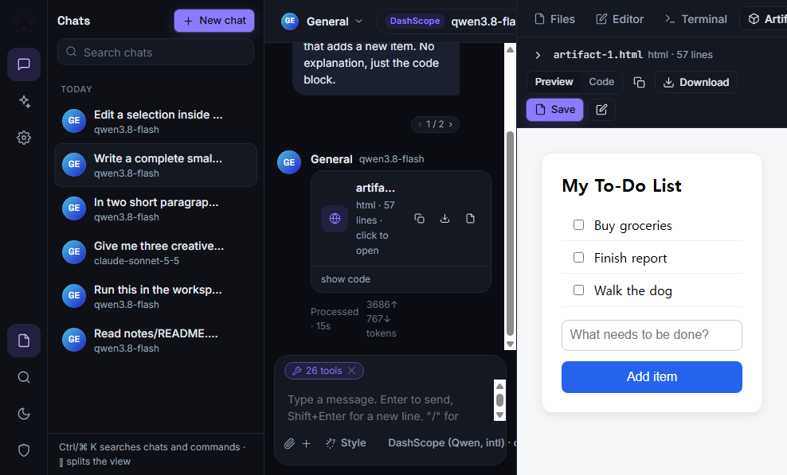

<table>
<tr>
<td width="50%">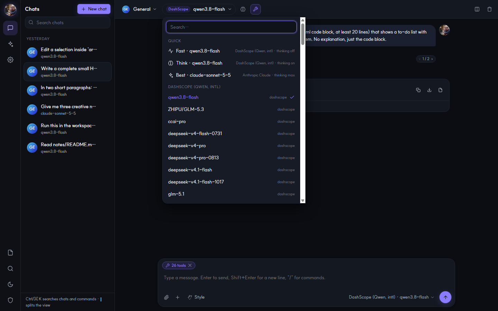<br><b>Model picker.</b> Quick presets first, then every model of every provider. Models whose server is down or whose key is missing are dimmed with the reason.</td>
<td width="50%">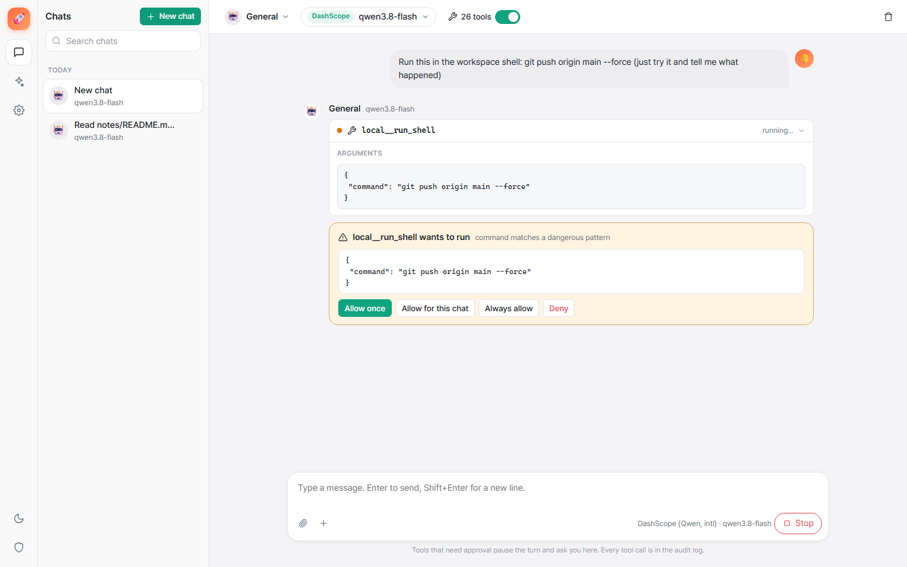<br><b>Approvals.</b> A tool that writes or runs things pauses the turn: allow once, in this chat, always, or deny. The permission mode under the message box sets this per chat.</td>
</tr>
<tr>
<td>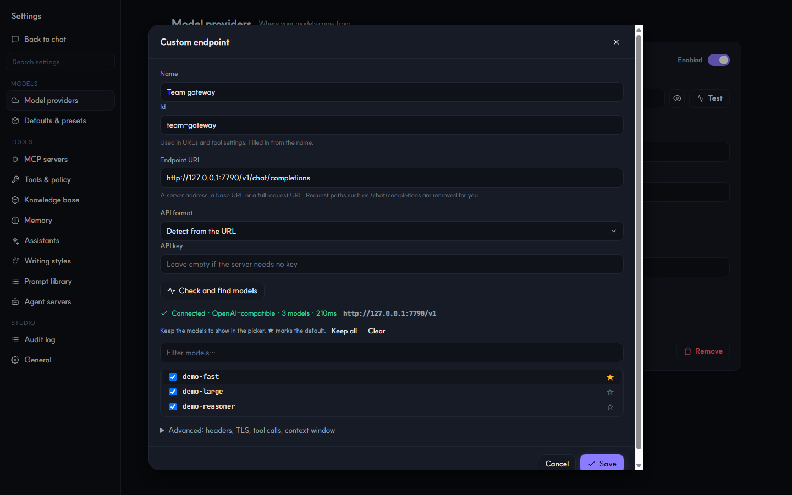<br><b>Custom endpoint.</b> Paste a host, a base URL or a full request URL and a key. The API format and base URL are found for you; tick the models to keep and star the default.</td>
<td>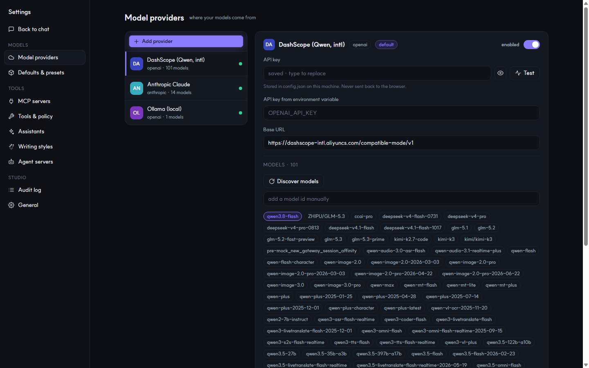<br><b>Providers.</b> Key (never sent back to the browser), base URL, test, and the model list: filter it, drop models from the picker, click one to make it the default.</td>
</tr>
<tr>
<td>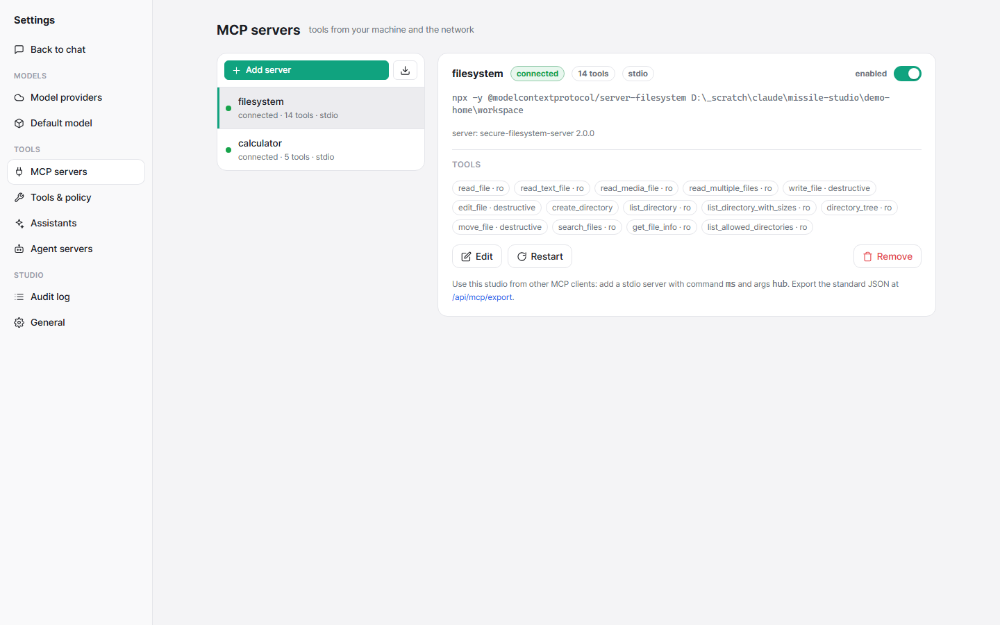<br><b>MCP servers.</b> Status, transport and the tools each server exposes, with read-only and destructive flags. Import the servers you already use in other MCP clients.</td>
<td>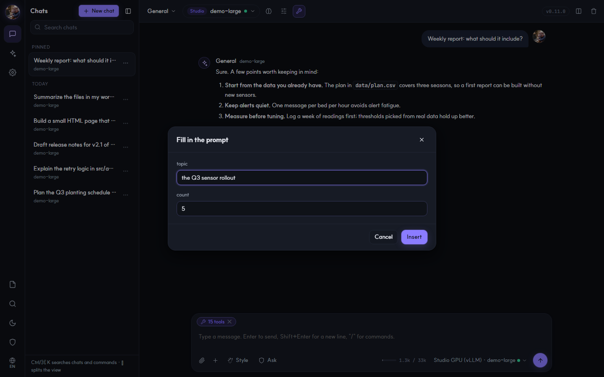<br><b>Prompt library.</b> Saved prompts go in with <code>/name</code>; <code>{{blanks}}</code> in them are asked for first.</td>
</tr>
</table>

**Split view.** Up to three chats side by side, each with its own model. Linked inputs send one message to
every pane, so you can compare models on the same prompt.

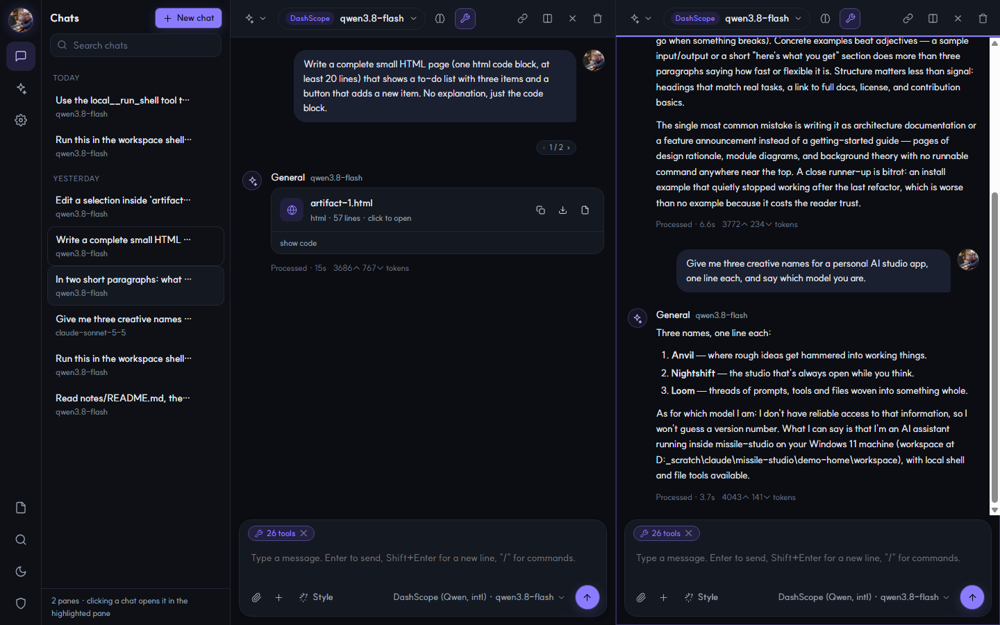

<table>
<tr>
<td width="50%">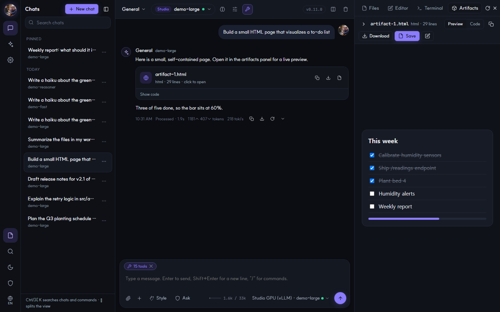<br><b>Artifacts.</b> Long code blocks and HTML, SVG, Markdown or JSON documents become cards with a live preview, copy, download and save to the workspace.</td>
<td width="50%">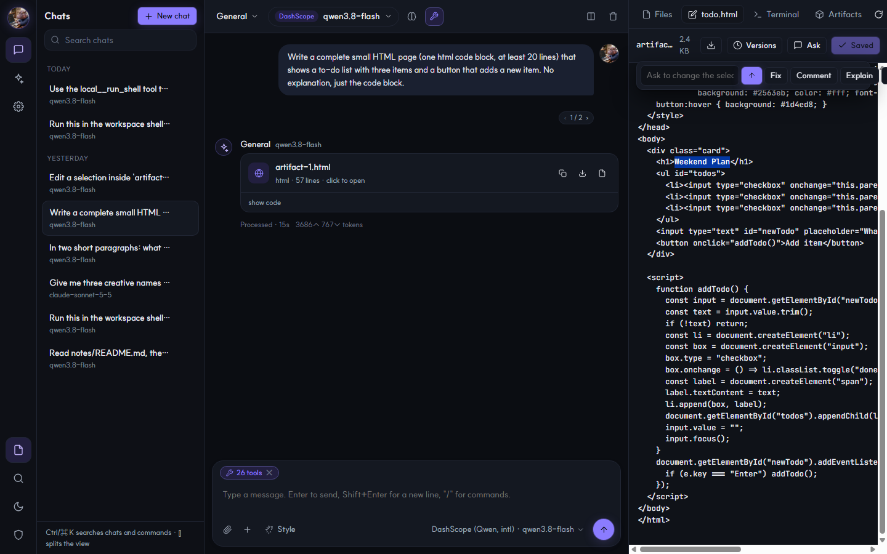<br><b>Workspace panel.</b> Files, an editor and a terminal over the folder the local tools work in. Select text to have the model fix, comment, explain or review it; changes come back as a diff.</td>
</tr>
<tr>
<td>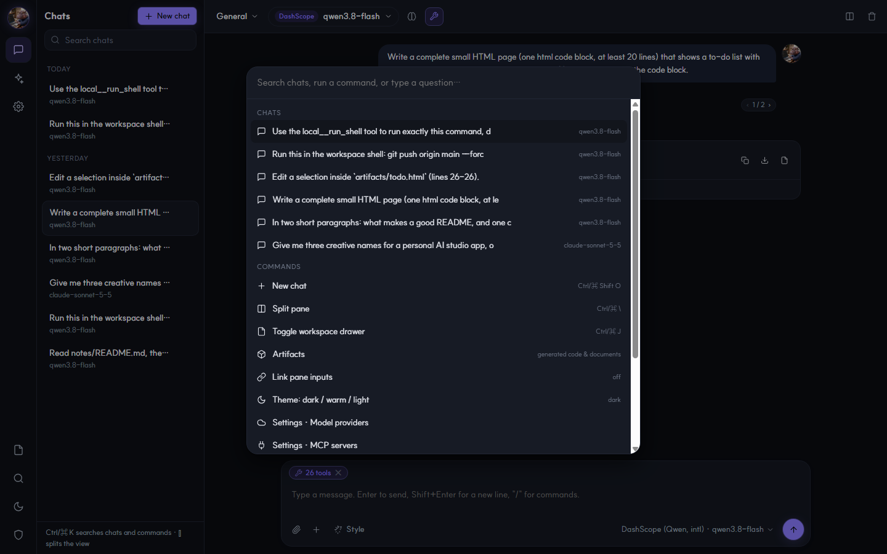<br><b>Search and commands.</b> <code>Ctrl/⌘ K</code> finds chats, runs any command or asks a question. <code>/</code> in the message box lists slash commands and saved prompts.</td>
<td>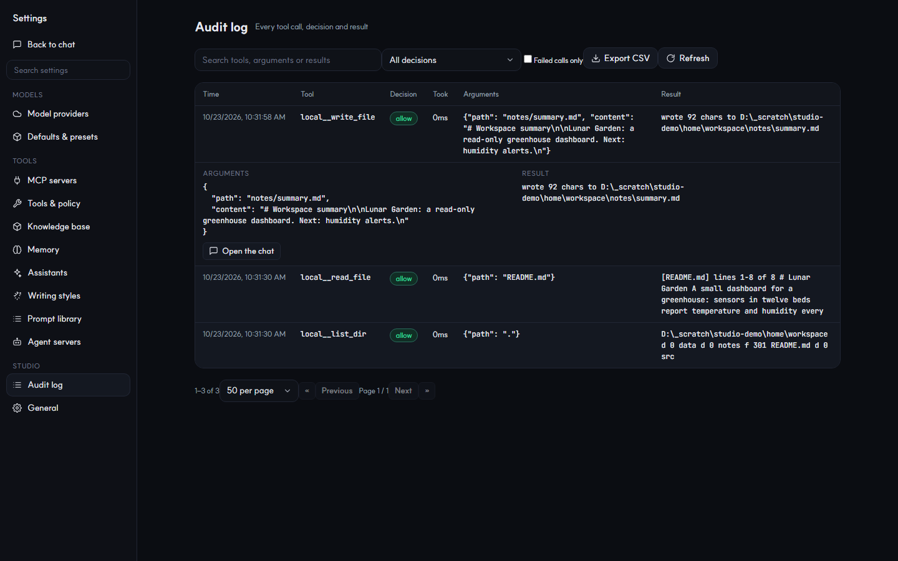<br><b>Audit log.</b> Every tool call with its decision and result. Page through it, search, filter by decision or failures, open a row in full, export as CSV.</td>
</tr>
<tr>
<td>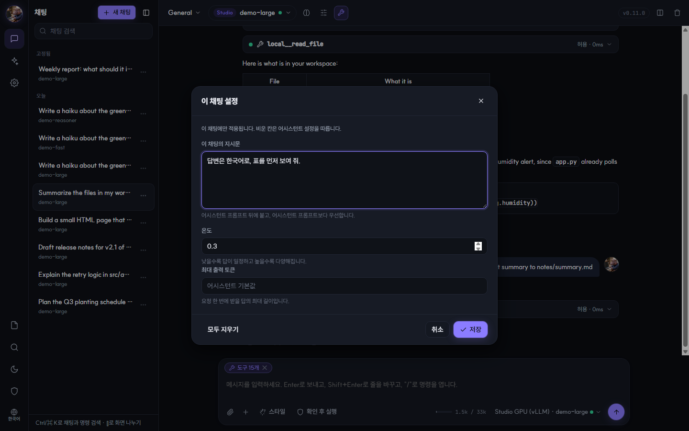<br><b>English or Korean.</b> The whole interface switches with the button at the bottom of the rail. Here, settings for one chat: its own instructions, temperature and answer length.</td>
<td>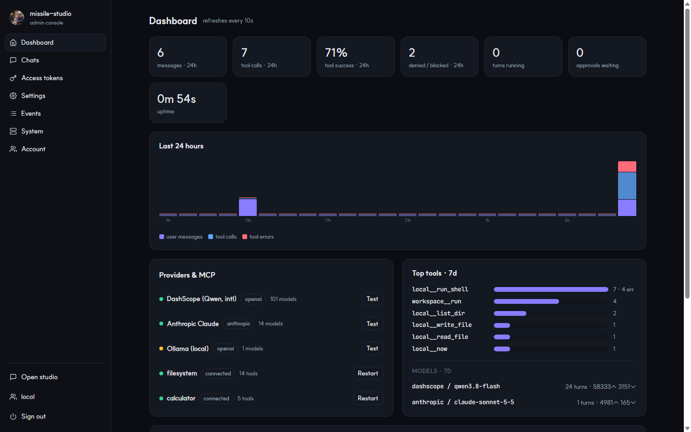<br><b>Admin console.</b> Warnings, 24-hour activity, provider and MCP health, access tokens, typed settings, events, system status and retention.</td>
</tr>
<tr>
<td>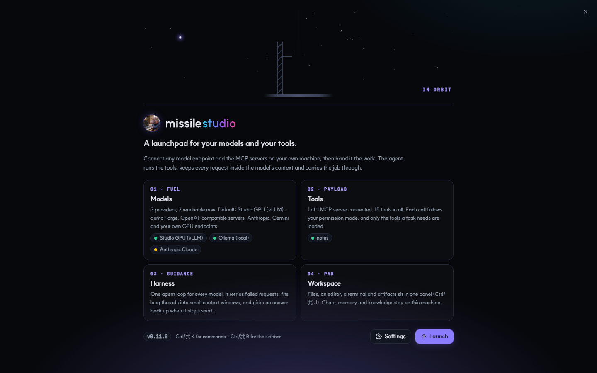<br><b>At a glance.</b> The mark in the corner opens a short intro to the four parts of the studio, filled with what is connected right now.</td>
<td>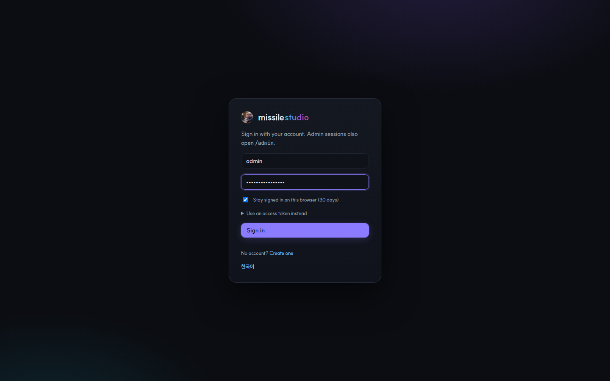<br><b>Sign in.</b> Admin and user accounts, invite-only sign-up by default. Your own picture is the mark and the tab icon (<code>static/brand/</code>).</td>
</tr>
</table>

## Install (anywhere)

```bash
# Linux / macOS / WSL
curl -fsSL https://raw.githubusercontent.com/jinsoo96/missile-studio/main/scripts/install.sh | sh

# Windows PowerShell
irm https://raw.githubusercontent.com/jinsoo96/missile-studio/main/scripts/install.ps1 | iex

# or by hand (Python 3.10+)
pip install "git+https://github.com/jinsoo96/missile-studio.git"
uv tool install "missile-studio @ git+https://github.com/jinsoo96/missile-studio.git"
pipx install "git+https://github.com/jinsoo96/missile-studio.git"

# Docker
docker run -d --name missile -p 7700:7700 -v missile-data:/data -e MISSILE_TOKEN=change-me ghcr.io/jinsoo96/missile-studio:latest
```

## 60 seconds

```bash
ms p add --preset openai --api-key sk-...      # provider: openai / anthropic / gemini / dashscope / openrouter / groq ...
ms p add --preset ollama --model qwen3:8b      # local, no key
ms m import claude-code                        # reuse the MCP servers you already use in Claude Code
ms m add fs -- npx -y @modelcontextprotocol/server-filesystem .   # or add any server by hand
ms doctor                                      # providers + MCP servers health
ms serve --open                                # web UI  → http://127.0.0.1:7700
ms chat                                        # terminal chat, same engine
ms ask --json "summarize README.md with local__read_file"   # scripting
```

Short forms: `ms s` (serve) · `ms c` (chat) · `ms a` / `ms q` (ask) · `ms p` (provider) · `ms m` (mcp) ·
`ms h` (hub) · `ms b` (bridge) · `ms dr` (doctor) · `ms admin` (users, tokens) · `ls` / `rm` inside `p`, `m` and `assistant`.

Config lives in `~/.missile-studio/config.json` (override with `MISSILE_HOME`). Secrets can stay out of
the file with `--api-key-env OPENAI_API_KEY`.

## What you get

| | |
|---|---|
| **Models** | OpenAI-compatible servers (OpenAI, vLLM, Ollama, LM Studio, llama.cpp, DashScope, OpenRouter, Groq, DeepSeek, Mistral, xAI, LiteLLM, any gateway), the Anthropic Messages API, Google Gemini and remote agent servers, with streaming, native tool calls, thinking and model discovery. Add one from a preset or by pasting any endpoint. Quick presets *Fast / Think / Best* sit at the top of the picker, and one thinking switch maps to each provider's own setting. Providers are health-checked every two minutes and right after a failed turn. |
| **GPU servers that move** | A provider can follow an endpoint file (`base_url\|model\|api_key`), so a recreated GPU pod is picked up without editing settings. An MCP server can carry a wake command that *Restart* runs first, with a progress bar and the time left; when the provider is down, the chat offers a Wake button. |
| **MCP client** | stdio, streamable HTTP and SSE servers, each on its own supervised connection (ping, reconnect with backoff, per-call timeout, stderr logs). Tools are named `server__tool`. Import from Claude Code, Claude Desktop, Cursor, Windsurf, VS Code, Cherry Studio or pasted JSON; export as standard `mcpServers` JSON. |
| **Local tools** | `run_shell`, `read_file`, `write_file`, `list_dir`, `search_files`, `fetch_url`, `web_search`, `now`, plus `memory_save` / `memory_search` and `knowledge_search`. Files and the shell are confined to a workspace folder (symlink-safe). |
| **Policy & audit** | Per-tool `allow / ask / block` with globs; read-only tools run, dangerous shell commands always ask. A permission mode per chat (Ask / Allow all / Read-only). Every call lands in the audit log, which pages, searches, filters and exports CSV. |
| **Harness** | One agent loop for every provider: concurrent tool calls, retries with backoff, history compaction, prompt caching, and tool calls through the prompt for servers without a tool parser. With many tools the model gets a one-line catalog and loads what it needs. Small context windows are respected end to end, a looping or cut-off turn is steered back, and every answer records why it ended. Details in [docs/ARCHITECTURE.md](docs/ARCHITECTURE.md#harness-small-models-and-long-runs). |
| **Assistants, styles, prompts** | Assistants carry a system prompt, preferred model, tool set, temperature and output length. Writing styles change the tone per chat. Chat settings give one chat its own instructions, temperature and answer length. The prompt library inserts saved prompts with `/name` and asks for their `{{blanks}}`. |
| **Chats** | Branches on edit and retry (`‹ ›`), retry with another model, up to three chats side by side with linked inputs, turns that keep running when the tab closes. Rename, pin, export (Markdown or JSON) from each chat's ⋯ menu. Drop files on the message box; images are saved to disk and their path is handed to tools. Answers show time, length, speed and why they ended. |
| **Search, memory, knowledge** | Full-text search over every chat (any language). Memories the assistant saves and recalls across chats. A knowledge base over your folders (keyword search, optional embeddings) whose best excerpts go into context, and `web_search` with cited answers or a full `/research` report. |
| **Workspace & artifacts** | A panel with the file tree, an editor with saved versions and model edits applied as a diff, and a terminal (admin only, audited). Artifacts preview HTML, SVG, Markdown and JSON in a sandbox. |
| **Interface** | English or Korean (the rail button, Settings → General, or the palette; the first visit follows the browser). Dark, warm and light themes, chat text size and a wide column. A resizable, hideable sidebar, settings search, `Ctrl/⌘ K` palette, `/` commands and a shortcut sheet (`Ctrl/⌘ /`). Notifications when an answer finishes in a background tab. Works in a phone browser too (the list opens over the chat). |
| **Hub & agent servers** | `ms hub` exposes every tool (local and MCP) as one MCP server over stdio or HTTP for other clients. Chat with agents on a remote agent platform; `ms bridge` lends this machine's tools to them through missile's policy. |
| **Admin & accounts** | `/admin`: dashboard, chats, access tokens with `chat` / `admin` scopes, typed settings, events, system status, log tails, retention. Admin and user accounts: a user sees only their own chats and gets only the tools you allow (web search by default, never this machine's shell or files). Sign-up off, by invite code (default) or open. `ms admin …` does the same from the shell. |
| **Remote** | Browser sign-in (30-day sessions) or an access token, generated automatically on a non-loopback bind. SSH port-forward friendly; recipes for Tailscale, Cloudflare Tunnel, Docker, systemd and a Windows scheduled task. |

PDF text in attachments and the knowledge base needs `pip install pypdf`.

## Remote use

```bash
# on the server
ms serve --host 0.0.0.0 --port 7700            # prints a token; or --token ... / MISSILE_TOKEN
# from your laptop, no ports exposed
ssh -L 7700:127.0.0.1:7700 user@server          # then open http://127.0.0.1:7700
# over SSH in the terminal
ssh -t user@server ms chat
```

More in [docs/GUIDE-remote.md](docs/GUIDE-remote.md) (Tailscale, Cloudflare Tunnel + Access, Docker, systemd, Windows task).

## Agent servers

```bash
ms p add --preset agentserver --id corp --base-url https://agents.example.com --email me@corp.com --password '...'
ms p models corp                 # lists agents (id|name) → pick one as the "model"
ms chat -p corp -m "wf_123|My agent"
ms bridge --provider corp        # this PC's tools appear to the platform's agents (device = <host> · missile-studio)
```

Details in [docs/GUIDE-agent-server.md](docs/GUIDE-agent-server.md).

## Architecture

```
src/missile_studio/
  config.py          config.json model (providers, mcp_servers, policy, assistants, presets, styles, prompts, server)
  store.py           SQLite: conversations (pins, per-chat settings), message tree (branches), tool audit, memory, knowledge
  engine.py          the agent loop: policy → approvals → execution → persistence → events, plus the harness
  providers/         base contract + openai_compat / anthropic / gemini / agentserver adapters, probe.py (pasted endpoints)
  mcp/manager.py     supervised MCP connections, namespaced catalog, call_tool
  mcp/importers.py   read other clients' MCP configs
  tools/builtin.py   local sandboxed tools + dangerous-command detector
  knowledge.py       chunks, keyword search, optional embeddings, rank fusion
  wake.py            wake commands with progress for servers that sleep
  server/app.py      FastAPI JSON API + SSE chat + auth (owner token, scoped tokens, admin sessions)
  server/admin.py    admin console backend: sessions, typed settings, dashboard, tokens, events, retention
  server/static/     web UI + admin UI (vanilla JS, no build step); i18n.js holds the Korean text
  tui.py / cli.py    terminal chat, one-shot ask, management commands
  hub.py             everything as one MCP server
  device_bridge.py   device WebSocket client for agent servers
```

Design notes are in [docs/ARCHITECTURE.md](docs/ARCHITECTURE.md).

## Develop

```bash
git clone https://github.com/jinsoo96/missile-studio && cd missile-studio
uv venv && uv pip install -e ".[dev]"      # or: pip install -e ".[dev]"
pytest -q                                  # providers (mock transports), MCP (real stdio fixture), engine, hub, API, UI text
```

New interface text goes through `T('…')` in the UI scripts, with its Korean in `static/i18n.js`; a test fails
when one is missing.

## License

Apache-2.0
