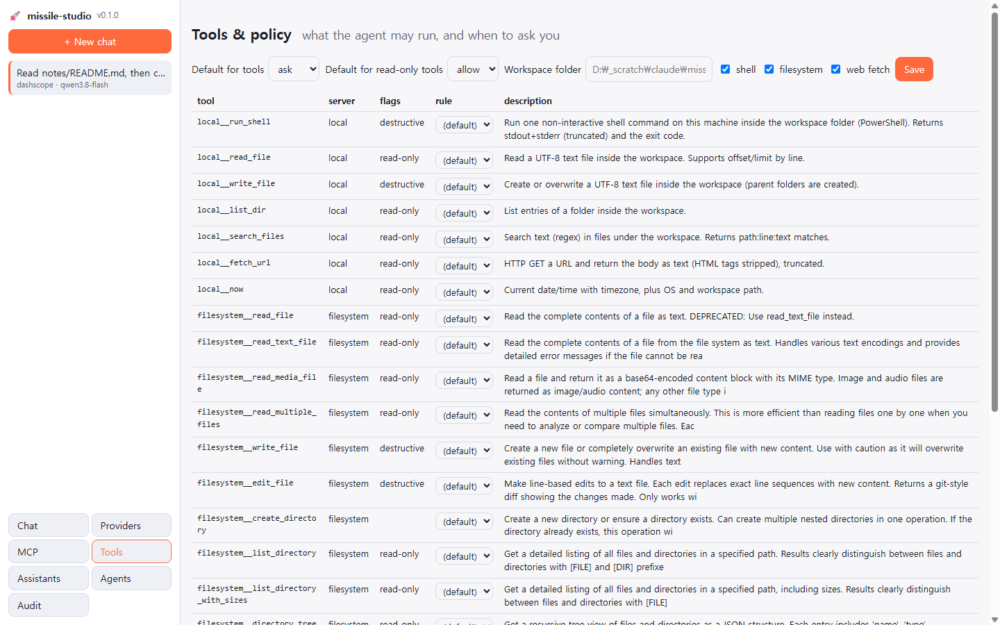

# missile-studio 🚀

**Your own LLM studio.** Many model providers, your local MCP servers and remote agent servers in one
place, driven by one agent loop. A web UI and a terminal UI share the same engine, so the same setup
works on a laptop, on a headless box over SSH, in Docker, or behind a tunnel.

Pure Python, installs in one line, remote-first. `missile` and the short alias `ms` are the same command.

```
   providers ──┐                                    ┌── web UI  (http://host:7700)
 OpenAI · Claude · Gemini · DashScope · OpenRouter   │
 Groq · DeepSeek · Mistral · xAI · Ollama · vLLM    │
 LM Studio · llama.cpp · LiteLLM · agent servers    ├── missile engine ──┬── terminal  (ms chat / ms ask)
                                                    │  (agent loop,      │
   tools ───────┤                                   │   policy, audit)   ├── MCP hub   (ms hub → Claude Code, Cursor, Claude Desktop)
 local: shell · files · search · fetch              │                    │
 MCP:  stdio · streamable-http · sse (any server)   ┘                    └── device bridge (ms bridge → remote agents use your PC)
```

## Screenshots

**Chat.** One column, one conversation. Every tool call is a card inline with the answer: name, arguments,
result, duration and the policy decision (green = ran, red = denied/error). Markdown answers, thinking
blocks collapsed, provider · model stamped under each message. Provider, model, assistant and the tools
switch live in the header, so you can change them mid-conversation.


**Approvals.** When a tool is `ask`-level (destructive hint, dangerous shell pattern, or your rule) the turn
pauses and a card appears above the composer: *Allow once · Allow for this chat · Always allow · Deny*.
The same prompt appears inline in the terminal UI.


**Providers.** Cards on the left, one form on the right. Pick a preset, paste a key (or a local base URL),
*Test* lists the models, *Discover models* fills the model dropdown. Keys are never sent back to the browser.


**MCP servers.** Status, tool count and transport per server, with restart/disable, plus one-click import
from the configs you already have in Claude Code, Claude Desktop, Cursor, Windsurf, VS Code or Cherry Studio.


**Tools & policy.** Every tool the agent can see, with its server, read-only/destructive flags and a per-tool
rule (allow / ask / block). Defaults for everything else, plus the workspace folder for local tools.



## Install (anywhere)

```bash
# Linux / macOS / WSL
curl -fsSL https://raw.githubusercontent.com/jinsoo96/missile-studio/main/scripts/install.sh | sh

# Windows PowerShell
irm https://raw.githubusercontent.com/jinsoo96/missile-studio/main/scripts/install.ps1 | iex

# or by hand (Python 3.10+)
pip install "git+https://github.com/jinsoo96/missile-studio.git"
uv tool install "missile-studio @ git+https://github.com/jinsoo96/missile-studio.git"
pipx install "git+https://github.com/jinsoo96/missile-studio.git"

# Docker
docker run -d --name missile -p 7700:7700 -v missile-data:/data -e MISSILE_TOKEN=change-me ghcr.io/jinsoo96/missile-studio:latest
```

## 60 seconds

```bash
ms p add --preset openai --api-key sk-...      # provider: openai / anthropic / gemini / dashscope / openrouter / groq ...
ms p add --preset ollama --model qwen3:8b      # local, no key
ms m import claude-code                        # reuse the MCP servers you already use in Claude Code
ms m add fs -- npx -y @modelcontextprotocol/server-filesystem .   # or add any server by hand
ms doctor                                      # providers + MCP servers health
ms serve --open                                # web UI  → http://127.0.0.1:7700
ms chat                                        # terminal chat, same engine
ms ask --json "summarize README.md with local__read_file"   # scripting
```

Short forms: `ms s` (serve) · `ms c` (chat) · `ms a` / `ms q` (ask) · `ms p` (provider) · `ms m` (mcp) ·
`ms h` (hub) · `ms b` (bridge) · `ms dr` (doctor) · `ls` / `rm` inside `p`, `m` and `assistant`.

Config lives in `~/.missile-studio/config.json` (override with `MISSILE_HOME`). Secrets can stay out of
the file with `--api-key-env OPENAI_API_KEY`.

## What you get

| | |
|---|---|
| **Providers** | OpenAI-compatible (OpenAI, vLLM, Ollama, LM Studio, llama.cpp, DashScope, OpenRouter, Groq, DeepSeek, Mistral, xAI, LiteLLM, any gateway), Anthropic Messages API, Google Gemini, **remote agent servers**. Streaming, native tool calling, thinking/reasoning deltas, model discovery, per-provider `extra_body` (Qwen `enable_thinking`, etc.). |
| **MCP client** | stdio / streamable-http / sse servers, one supervised connection each (ping, backoff reconnect, per-call timeout, stderr logs). Tool names are `server__tool`. Import from Claude Code, Claude Desktop, Cursor, Windsurf, VS Code, Cherry Studio or pasted JSON. Export back as standard `mcpServers` JSON. |
| **Local tools** | `local__run_shell`, `read_file`, `write_file`, `list_dir`, `search_files`, `fetch_url`, `now`. Sandboxed to a workspace folder (symlink-safe). |
| **Policy & approvals** | Per-tool `allow / ask / block` (globs like `fs__*`), read-only tools allowed by default, destructive hints and dangerous shell commands (`rm -rf`, `git push --force`, `curl | sh` ...) always ask. Approve once / for this chat / always, in the browser or in the terminal. Every call lands in an **audit log**. |
| **Assistants** | System prompt + preferred provider/model + tool set + iteration cap. |
| **Conversations** | SQLite, resumable, attachments (text/code/markdown/pdf*/images), markdown rendering, thinking blocks, tool cards. |
| **Hub** | `ms hub` exposes *everything* (local tools + all MCP servers) as **one** MCP server over stdio or HTTP. Point Claude Code, Cursor or Claude Desktop at it. |
| **Agent servers** | Chat with agents hosted on a remote agent platform (login, agent list, SSE stream, server-side tool events). `ms bridge` registers this machine as a device on that platform, so its agents can call your local tools and MCP servers through missile's policy. |
| **Remote** | Token auth (auto-generated when bound to a non-loopback address), SSH port-forward friendly, Tailscale / Cloudflare Tunnel recipes, Docker image, systemd unit, Windows scheduled task. |

\* PDF text needs `pip install pypdf`.

## Remote use

```bash
# on the server
ms serve --host 0.0.0.0 --port 7700            # prints a token; or --token ... / MISSILE_TOKEN
# from your laptop, no ports exposed
ssh -L 7700:127.0.0.1:7700 user@server          # then open http://127.0.0.1:7700
# over SSH in the terminal
ssh -t user@server ms chat
```

More in [docs/GUIDE-remote.md](docs/GUIDE-remote.md) (Tailscale, Cloudflare Tunnel + Access, Docker, systemd, Windows task).

## Agent servers

```bash
ms p add --preset agentserver --id corp --base-url https://agents.example.com --email me@corp.com --password '...'
ms p models corp                 # lists agents (id|name) → pick one as the "model"
ms chat -p corp -m "wf_123|My agent"
ms bridge --provider corp        # this PC's tools appear to the platform's agents (device = <host> · missile-studio)
```

Details in [docs/GUIDE-agent-server.md](docs/GUIDE-agent-server.md).

## Architecture

```
src/missile_studio/
  config.py          config.json model (providers, mcp_servers, policy, assistants, server)
  store.py           SQLite: conversations, messages, tool audit
  providers/         base contract + openai_compat / anthropic / gemini / agentserver adapters
  mcp/manager.py     supervised MCP connections, namespaced catalog, call_tool
  mcp/importers.py   read other clients' MCP configs
  tools/builtin.py   local sandboxed tools + dangerous-command detector
  engine.py          the agent loop: policy → approvals → execution → persistence → events
  server/            FastAPI JSON API + SSE chat + static web UI (vanilla JS, no build step)
  tui.py / cli.py    terminal chat, one-shot ask, management commands
  hub.py             everything as one MCP server
  device_bridge.py   device WebSocket client for agent servers
```

Design notes are in [docs/ARCHITECTURE.md](docs/ARCHITECTURE.md).

## Develop

```bash
git clone https://github.com/jinsoo96/missile-studio && cd missile-studio
uv venv && uv pip install -e ".[dev]"      # or: pip install -e ".[dev]"
pytest -q                                  # providers (mock transports), MCP (real stdio fixture), engine, hub, API
```

## License

Apache-2.0
